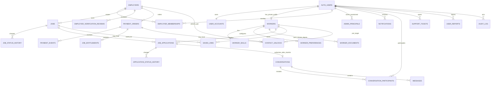

# FleetWala schema relationship diagram

**Proposed PostgreSQL schema; UNEXECUTED and not production-ready.**
Identity arrows to Auth reference Supabase `auth.users(id)`. Worker discovery
does not expose the worker relation directly to employers.

## Trust boundaries

- `workers` contains personal contact/address/profile fields. Table RLS is
  owner-only for regular users. `discover_workers` is a narrowly scoped
  employer RPC that selects only opaque handle, city, category, experience and
  vehicle for active profiles with explicit discoverability on.
- Application writes, status changes, moderation, chat sends, admin account
  state changes, membership setup and audit writes are trusted routines or
  owner-only provisioning; clients do not receive direct write grants for the
  underlying sensitive ledgers.
- `worker-private-documents` is a private Storage bucket with owner-UUID
  object paths. Metadata is stored separately and does not publish object URLs.
- Billing ledger tables are read-only to clients and the billing singleton is
  disabled. No payment callback, entitlement grant, or contact-return endpoint
  is provided.
